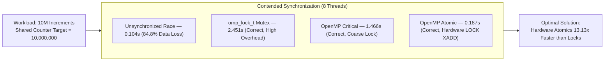
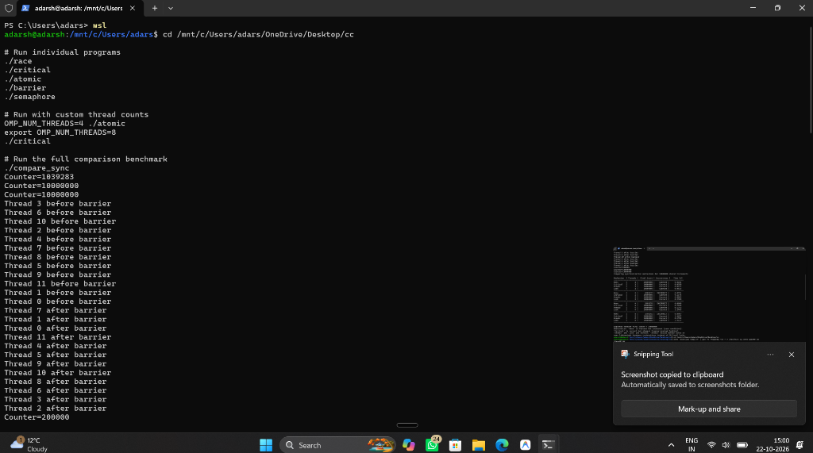
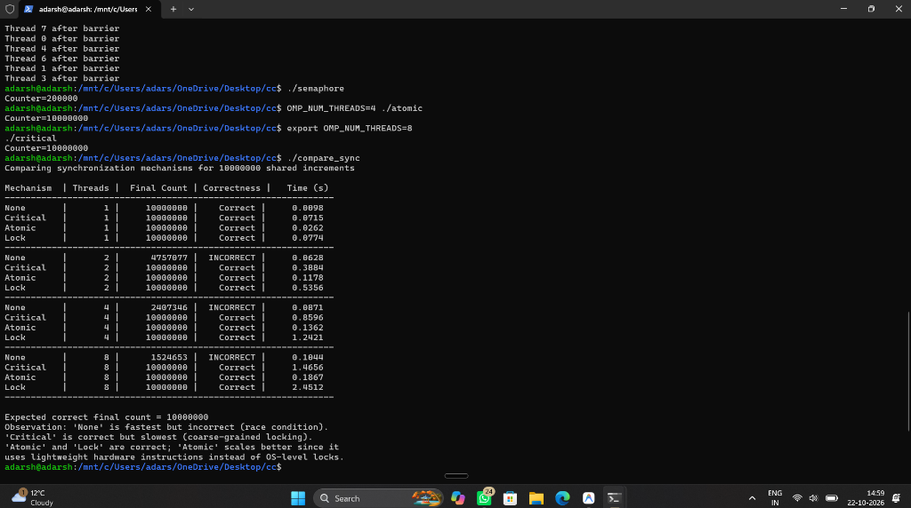
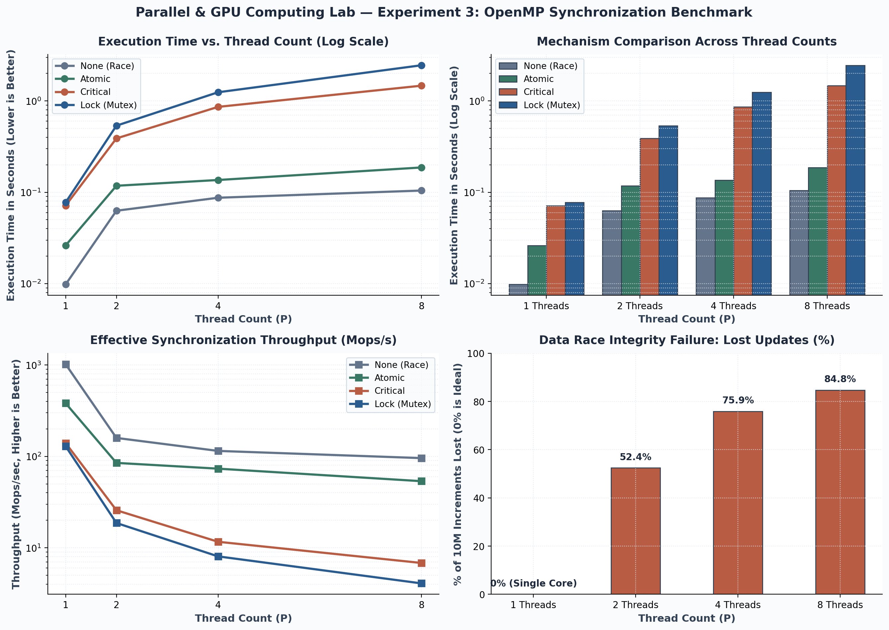
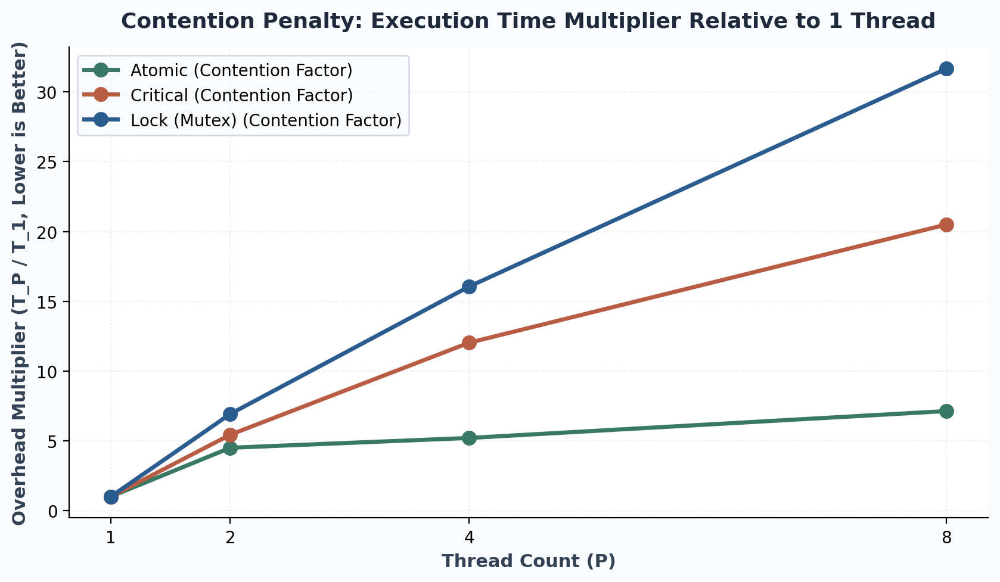

# Lab Experiment 3: OpenMP Synchronization & Concurrency Benchmark

[](#)
[](#)
[](#)
[](#)

---

## Executive Summary

Empirical concurrency analysis benchmarking mutual exclusion primitives, data race integrity failures, and synchronization contention overheads across 1, 2, 4, and 8 threads on **10,000,000 shared counter increments**.



> **Key Finding**: Hardware Atomics (`#pragma omp atomic`) completed 10 million increments in **0.1867s at 8 threads**—**7.85× faster than Critical sections (1.4656s)** and **13.13× faster than OS Locks (`omp_lock_t` at 2.4512s)** while ensuring 100% deterministic correctness. Conversely, unsynchronized execution destroyed **84.75% of updates**.

---

## Repository Structure

```text
Lab_Experiment_3/
├── graphs/                  # Generated benchmark dashboards and contention plots
├── images/                  # Terminal outputs and execution screenshots
├── scripts/
│   └── generate_charts.py   # Python script to regenerate performance charts
├── src/
│   ├── atomic.c, barrier.c, critical.c, race.c, semaphore.c, compare_sync.c
│   └── Makefile
├── .gitignore
└── README.md
```

---

## 1. Synchronization Primitives Comparison

- **Workload**: $10,000,000$ shared increments ($N/P$ per thread).
- **Correctness Condition**: Final count must equal exactly $10,000,000$.

| Mechanism | Implementation Type | Microarchitectural Behavior | Correctness |
| :--- | :--- | :--- | :---: |
| **None (Race)** | Unsynchronized `counter++` | Non-atomic Read-Modify-Write collision | ❌ **Failed (Up to 84.8% lost)** |
| **Atomic** | `#pragma omp atomic` | Hardware bus/cache locking (`LOCK XADD`) |  **Correct (10,000,000)** |
| **Critical** | `#pragma omp critical` | Compiler-managed mutual exclusion queue |  **Correct (10,000,000)** |
| **Lock (`omp_lock_t`)** | OS Mutex / Futex wrapper | User spinning degrading to kernel sleep |  **Correct (10,000,000)** |
| **Barrier** | `#pragma omp barrier` | Phased rendezvous synchronization point |  **Deterministic Alignment** |

---

## 2. Source Code References

All implementations and build automation reside in [`src/`](src/):

| Component | Source Link | Description |
| :--- | :--- | :--- |
| **Data Race Demo** | [`src/race.c`](src/race.c) | Unsynchronized counter increment exposing race condition |
| **Critical Section** | [`src/critical.c`](src/critical.c) | Mutual exclusion using `#pragma omp critical` |
| **Hardware Atomic** | [`src/atomic.c`](src/atomic.c) | Lightweight atomic updates using `#pragma omp atomic` |
| **Lock / Semaphore** | [`src/semaphore.c`](src/semaphore.c) | Low-level mutex routines using `omp_lock_t` |
| **Barrier Phase Sync** | [`src/barrier.c`](src/barrier.c) | Coordinated two-phase workflow via `#pragma omp barrier` |
| **Full Benchmark** | [`src/compare_sync.c`](src/compare_sync.c) | Automated benchmark comparing all mechanisms (1 to 8 threads) |
| **Build File** | [`src/Makefile`](src/Makefile) | Compilation setup (`gcc -fopenmp -O2 -Wall`) |

---

## 3. Empirical Results & Terminal Outputs

### 3.1 Individual Target Execution & Barrier Phase Alignment
Demonstrating data race errors, correct mutual exclusion across primitives, and two-phase barrier synchronization:



---

### 3.2 Full Multi-Threaded Benchmark Output (`compare_sync`)
Benchmark output comparing all synchronization primitives across 1, 2, 4, and 8 threads:



---

## 4. Performance Comparison & Charts

### Benchmark Measurements (10,000,000 Increments)

| Mechanism | Threads ($P$) | Final Count | Status | Time (s) | Overhead (vs 1T) | Throughput |
| :--- | :---: | :---: | :---: | :---: | :---: | :---: |
| **None (Race)** | 1 | 10,000,000 |  Correct | `0.0098 s` | 1.00× | 1,020 Mops/s |
| **Atomic** | 1 | 10,000,000 |  Correct | `0.0262 s` | 1.00× | 382 Mops/s |
| **Critical** | 1 | 10,000,000 |  Correct | `0.0715 s` | 1.00× | 140 Mops/s |
| **Lock (`omp_lock_t`)** | 1 | 10,000,000 |  Correct | `0.0774 s` | 1.00× | 129 Mops/s |
| **None (Race)** | 2 | 4,757,077 | ❌ **52.4% Lost** | `0.0628 s` | 6.41× | 159 Mops/s |
| **Atomic** | 2 | 10,000,000 |  Correct | `0.1178 s` | 4.50× | 85 Mops/s |
| **Critical** | 2 | 10,000,000 |  Correct | `0.3884 s` | 5.43× | 26 Mops/s |
| **Lock (`omp_lock_t`)** | 2 | 10,000,000 |  Correct | `0.5356 s` | 6.92× | 19 Mops/s |
| **None (Race)** | 4 | 2,407,346 | ❌ **75.9% Lost** | `0.0871 s` | 8.89× | 115 Mops/s |
| **Atomic** | 4 | 10,000,000 |  Correct | `0.1362 s` | 5.20× | 73 Mops/s |
| **Critical** | 4 | 10,000,000 |  Correct | `0.8596 s` | 12.02× | 12 Mops/s |
| **Lock (`omp_lock_t`)** | 4 | 10,000,000 |  Correct | `1.2421 s` | 16.05× | 8 Mops/s |
| **None (Race)** | 8 | 1,524,653 | ❌ **84.8% Lost** | `0.1044 s` | 10.65× | 96 Mops/s |
| **Atomic** | 8 | 10,000,000 |  Correct | **`0.1867 s`** | **7.13×** | **54 Mops/s** |
| **Critical** | 8 | 10,000,000 |  Correct | `1.4656 s` | 20.50× | 7 Mops/s |
| **Lock (`omp_lock_t`)** | 8 | 10,000,000 |  Correct | `2.4512 s` | 31.67× | 4 Mops/s |

### Performance Dashboards

#### 4-Panel Performance Dashboard


#### Contention Overhead Scaling


---

## 5. Key Technical Takeaways

- **Hardware Atomic Dominance**: Emits single indivisible x86 instructions (`LOCK XADD`), avoiding OS scheduler involvement. It executes in **0.1867s at 8 threads (54 Mops/s)**—**13.13× faster than `omp_lock_t`**.
- **Data Race Severity**: Unsynchronized concurrent increments overwrite shared memory cache lines, resulting in **84.75% lost data at 8 threads**.
- **Critical Section Queueing Delay**: Coarse locking serializes all worker threads into a single queue, incurring a **20.50× contention slowdown at 8 threads**.
- **Lock System Overhead**: `omp_lock_t` incurs the steepest penalty (**31.67× slowdown**), caused by user-space spinning degrading into kernel-level futex sleeps and context switches.
