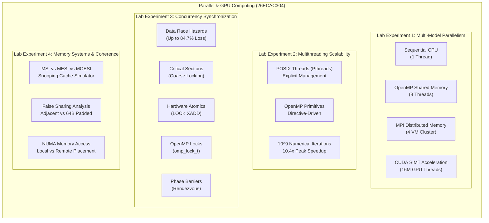

# Parallel & GPU Computing Laboratory (PGC Lab)

[](#)
[](#)
[](#)
[](#)
[](#)

A comprehensive laboratory repository featuring empirical benchmarks, microarchitectural analyses, mathematical formulations, and implementation source code for high-performance computing, distributed message passing, shared-memory synchronization, cache coherence protocols, and non-uniform memory architectures (NUMA).

---

## 📑 Master Laboratory Experiments Catalog

| Experiment | Title | Paradigms & Tools | Key Empirical Highlights | Documentation & Code |
| :--- | :--- | :--- | :--- | :--- |
| **Lab 1** | **Performance Analysis of Matrix Multiplication** | Sequential C, OpenMP (8T), MPI (4-VMs), CUDA (RTX 5060 Ti) | $4000 \times 4000$ matrix multiplication; **1,155.63× CUDA speedup** (0.211s vs. 244.12s sequential CPU) | [**Lab Experiment 1**](Lab_Experiment_1/README.md) • [`Lab_Experiment_1/`](Lab_Experiment_1/) |
| **Lab 2** | **Multithreaded Programming with Pthreads & OpenMP** | POSIX Threads (`pthreads`), OpenMP, Mutex, Critical, Barriers | $10^9$ numerical iterations; **10.4× speedup** on 16 threads (~98.4% parallel efficiency up to 6 threads) | [**Lab Experiment 2**](Lab_Experiment_2/README.md) • [`Lab_Experiment_2/`](Lab_Experiment_2/) |
| **Lab 3** | **OpenMP Synchronization & Concurrency Benchmark** | Race Conditions, Critical Section, Hardware Atomic, Mutex Lock, Barrier | 10M shared increments; **Hardware Atomics 7.85× faster than Critical** and **13.13× faster than Locks** under contention | [**Lab Experiment 3**](Lab_Experiment_3/README.md) • [`Lab_Experiment_3/`](Lab_Experiment_3/) |
| **Lab 4** | **Cache Coherence (MSI/MESI/MOESI) & NUMA Performance** | Snooping Simulator, False Sharing (Adjacent vs Padded), NUMA Sweeps | **DRAM writebacks eliminated via MOESI Owned state**; **118× speedup via 64B cache line padding**; **23.75 GB/s NUMA sweep** | [**Lab Experiment 4**](Lab_Experiment_4/README.md) • [`Lab_Experiment_4/`](Lab_Experiment_4/) |

---

## 🏛️ Course Architecture & Paradigm Overview



---

## 🔬 Consolidated Benchmark Summary

| Experiment | Workload Specification | Baseline Metric | Optimized Metric | Measured Speedup / Gain |
| :--- | :--- | :---: | :---: | :---: |
| **Lab 1: Matrix Multiplication** | $4000 \times 4000$ Matrix Multiplication ($C = A \times B$) | Sequential CPU: `244.120 s` | CUDA GPU: **`0.211 s`** | **1,155.63× Acceleration** |
| **Lab 2: Multithreaded Sum** | $1,000,000,000$ ($10^9$) Numerical Iterations | Sequential CPU: `1.418 s` | 16-Thread OpenMP: **`0.136 s`** | **10.41× Speedup** |
| **Lab 3: Concurrency Control** | $10,000,000$ ($10^7$) Contended Shared Increments | OpenMP Lock: `2.451 s` (8T) | Hardware Atomic: **`0.187 s`** (8T) | **13.13× Higher Throughput** |
| **Lab 4: Cache Coherence & NUMA** | $100,000,000$ ($10^8$) Increments + 512 MB Sweep | Adjacent (False Sharing): `0.022 s` | 64B Padded Layout: **`0.012 s`** | **1.85× False Sharing Mitigation** (20.33 GB/s NUMA Sweep) |

---

## 📁 Repository Directory Hierarchy

Every laboratory experiment is structured into an independent, self-contained sub-repository featuring source implementations, build automation (`Makefile`), empirical terminal screenshots, automated chart generation scripts, and detailed technical reports:

```
PGC_Lab/
├── README.md                                           # Master Laboratory Catalog & Benchmark Hub
├── .gitignore                                          # Global build and runtime artifact ignore rules
│
├── Lab_Experiment_1/                                   # Lab 1: Multi-Paradigm Matrix Multiplication
│   ├── README.md                                       # Empirical Report & Mathematical Verification
│   ├── .gitignore                                      # Build artifact exclusions
│   ├── images/                                         # CUDA environment, MPI cluster & execution screenshots
│   ├── scripts/
│   │   └── generate_charts.py                          # Chart generation (Execution time & Speedup)
│   └── src/
│       ├── sequential/matrix_sequential.c              # Baseline single-threaded triple-loop implementation
│       ├── openmp/matrix_openmp.c                      # Multi-threaded shared-memory implementation
│       ├── mpi/matrix_mpi.c                            # Distributed cluster implementation (Scatter/Gather)
│       ├── mpi/mpi_send_recv.c                         # Point-to-point MPI verification test
│       └── cuda/matrix_cuda.cu                         # Massively parallel SIMT CUDA kernel implementation
│
├── Lab_Experiment_2/                                   # Lab 2: Multithreaded Programming (Pthreads & OpenMP)
│   ├── README.md                                       # Comprehensive Scalability & Thread Report
│   ├── .gitignore                                      # Build artifact exclusions
│   ├── images/                                         # 20 empirical execution logs & benchmark charts
│   ├── scripts/
│   │   └── generate_charts.py                          # 3-panel performance & parallel efficiency charts
│   └── src/
│       ├── pthreads/                                   # Low-level POSIX threads implementations
│       │   ├── thread1.c, thread2.c, thread_sum.c      # Thread lifecycle & work distribution
│       │   ├── race.c, mutex.c, pthread_perf.c         # Concurrency hazards & mutex synchronization
│       │   └── sequential.c                            # Single-threaded numerical baseline
│       └── openmp/                                     # High-level OpenMP implementations
│           ├── omp1.c, omp_sum.c, omp_race.c           # Parallel regions & reduction clauses
│           ├── omp_critical.c, omp_barrier.c           # Critical section & barrier synchronization
│           └── omp_perf.c                              # Scalability micro-benchmark (1 to 16 threads)
│
├── Lab_Experiment_3/                                   # Lab 3: OpenMP Synchronization & Concurrency
│   ├── README.md                                       # Synchronization & Contention Benchmark Report
│   ├── .gitignore                                      # Build artifact exclusions
│   ├── graphs/                                         # Heatmaps, overhead growth & throughput charts
│   ├── images/                                         # Empirical execution screenshots from laboratory VM
│   ├── scripts/
│   │   └── generate_charts.py                          # Multi-metric comparative chart generator
│   └── src/
│       ├── Makefile                                    # Automated GCC build rules
│       ├── race.c                                      # Unsynchronized data race demonstration
│       ├── critical.c                                  # Compiler critical section mutual exclusion
│       ├── atomic.c                                    # Hardware atomic instruction benchmark
│       ├── barrier.c                                   # Two-phase barrier synchronization
│       ├── semaphore.c                                 # OpenMP runtime mutex/lock primitive
│       └── compare_sync.c                              # Automated comparative benchmark suite
│
└── Lab_Experiment_4/                                   # Lab 4: Cache Coherence Protocols & NUMA
    ├── README.md                                       # Microarchitectural Report & Protocol Analysis
    ├── .gitignore                                      # Build artifact exclusions
    ├── docs/
    │   └── Exp_4_Cache_Coherence_NUMA.pdf              # Official syllabus laboratory manual
    ├── images/                                         # Empirical terminal screenshots & dashboard charts
    ├── scripts/
    │   └── generate_charts.py                          # Coherence bus traffic & false sharing charts
    └── src/
        ├── Makefile                                    # Automated build configuration
        ├── coherence_sim.py                            # Cycle-accurate MSI/MESI/MOESI protocol simulator
        ├── false_sharing.c                             # Adjacent vs 64-byte padded layout benchmark
        ├── numa_sweep.c                                # 512 MB memory sweep bandwidth benchmark
        └── compare_numa.c                              # Unified False Sharing & NUMA evaluation program
```

---

## ⚙️ Hardware & Software Environment

| Category | Specification | Details |
| :--- | :--- | :--- |
| **Host Processor** | 13th Gen Intel(R) Core(TM) i5-13420H | 8 Cores (4 P-Cores + 4 E-Cores), 12 Threads, 12 MB Smart Cache |
| **Host GPU** | NVIDIA GeForce RTX 5060 Ti | 16 GB GDDR6 VRAM, CUDA Compute Capability 9.0+, Driver 617.14 |
| **Operating Systems** | Ubuntu 22.04 LTS (WSL2 / VMware) | Linux Kernel 5.15+ (x86_64 architecture) |
| **Compiler Toolchains** | GCC 15.2.0 / Clang 14.0 | C99 / C11 standards with `-O2 -Wall -fopenmp` |
| **GPU Framework** | NVIDIA CUDA Toolkit 13.4 | `nvcc` compiler with SIMT grid-stride loop execution |
| **Distributed Tools** | MPICH / OpenMPI 4.1 | Distributed execution across 4 virtualized cluster nodes |
| **Analysis Utilities** | `numactl`, `hwloc`, Python 3 | NUMA policy binding, hardware topology, and Matplotlib plotting |

---

## 👨‍💻 Author

- **Janaki M**
- GitHub: [@Janaki1711](https://github.com/Janaki1711)
- Department of Computer Science and Engineering (Artificial Intelligence)
- Course: Parallel and GPU Computing (26ECAC304)
