# Experiment 3: OpenMP Synchronization & Concurrency Benchmark

[](#)
[](#)
[](#)
[](#)

---

## Executive Summary

This study provides a rigorous empirical and microarchitectural benchmark of **OpenMP synchronization primitives** on shared-memory multi-core architectures. Evaluating four primary synchronization approaches—**None (Unsynchronized Race)**, **Critical Section (`#pragma omp critical`)**, **Hardware Atomic (`#pragma omp atomic`)**, and **Lock / Mutex (`omp_lock_t`)**—alongside phase coordination via **Barrier (`#pragma omp barrier`)**, this benchmark quantifies mutual exclusion overhead and scalability bottlenecks under heavy contention across 1, 2, 4, and 8 thread configurations performing $10,000,000$ shared counter increments.

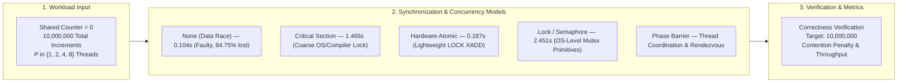

### Key Finding

> **Hardware-level Atomic synchronization (`#pragma omp atomic`) demonstrates exceptional scaling resilience under heavy multi-threaded contention, completing 10 million increments in 0.1867 seconds at 8 threads. It is 7.85× faster than OpenMP Critical sections (1.4656s) and 13.13× faster than OS-level locks (`omp_lock_t` at 2.4512s) while ensuring 100% deterministic correctness. Conversely, unsynchronized execution suffers catastrophic data loss, dropping up to 84.75% of updates due to concurrent Read-Modify-Write hazards.**

---

## Table of Contents

1. [Experiment Objectives](#1-experiment-objectives)
2. [Theoretical & Architectural Comparison](#2-theoretical--architectural-comparison)
3. [Workload Specification & Mathematical Model](#3-workload-specification--mathematical-model)
4. [Source Code References](#4-source-code-references)
5. [Empirical Results & Screenshots](#5-empirical-results--screenshots)
6. [Performance Comparison & Visualizations](#6-performance-comparison--visualizations)
7. [In-Depth Technical Analysis & Discussion](#7-in-depth-technical-analysis--discussion)
8. [How to Build & Run](#8-how-to-build--run)
9. [Conclusion & Engineering Takeaways](#9-conclusion--engineering-takeaways)

---

## 1. Experiment Objectives

1. **Race Condition Demonstration**: Empirically expose the hazards of unsynchronized shared-memory access, quantifying the severity of lost updates as thread counts scale.
2. **Mutual Exclusion Comparison**: Benchmark the execution time, overhead, and throughput of high-level compiler directives (`#pragma omp critical`), hardware primitives (`#pragma omp atomic`), and low-level runtime lock routines (`omp_lock_t`).
3. **Phase Synchronization**: Implement and verify barrier synchronization (`#pragma omp barrier`) to coordinate multi-phase multi-threaded workflows.
4. **Contention Scalability Analysis**: Measure the performance degradation caused by thread contention across 1, 2, 4, and 8 CPU threads, isolating OS context-switching penalties from hardware cache coherency traffic.

---

## 2. Theoretical & Architectural Comparison

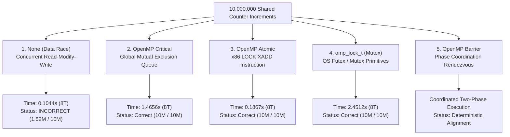

### Architectural Breakdown

#### 1. Unsynchronized Execution (Data Race)
In unsynchronized shared-memory execution, each thread performs an increment via a non-atomic three-step CPU sequence:
1. `MOV EAX, [counter]` (Read from memory/cache into local register)
2. `ADD EAX, 1` (Modify register value)
3. `MOV [counter], EAX` (Write back register value to shared memory)

When multiple CPU cores execute this sequence concurrently without memory barriers, interleaving occurs: Thread B reads the counter before Thread A writes back its increment, causing Thread B's write to overwrite and destroy Thread A's update.

#### 2. OpenMP Critical Section (`#pragma omp critical`)
Compiler directive enforcing coarse-grained mutual exclusion. The runtime associates a global internal lock with the structured code block. Only one thread can enter the critical region at any given instant; all other threads are blocked and placed into a wait queue. While structurally safe, the serialization of fine-grained increments introduces catastrophic queueing delay under high thread contention.

#### 3. OpenMP Atomic Operations (`#pragma omp atomic`)
Instructs the compiler to emit specialized hardware-level atomic instructions (such as `LOCK XADD` or `LOCK CMPXCHG` on x86-64 architectures). 
- **Hardware Bus & Cache Locking**: Instead of software locks or OS scheduler involvement, the CPU hardware locks the specific cache line containing the shared variable via the MESI cache coherency protocol.
- **Minimal Footprint**: Threads execute the read-modify-write as a single indivisible cycle at the memory controller, bypassing thread sleep, context switches, and kernel boundary crossings.

#### 4. OpenMP Locks / Semaphores (`omp_lock_t`)
Low-level mutex API providing explicit lock acquisition (`omp_set_lock`) and release (`omp_unset_lock`). 
- **OS Mutex / Futex Wrappers**: OpenMP lock implementations typically interface with operating system synchronization primitives (e.g., Linux `futex` or Windows `CRITICAL_SECTION`).
- **Scheduling Overhead**: When multiple threads contend for the same lock, unsuccessful threads may be put to sleep by the kernel scheduler. The subsequent thread wakeups, context switches, and cache invalidations incur high latency.

#### 5. OpenMP Barrier (`#pragma omp barrier`)
A phase-synchronization primitive rather than a mutual exclusion mechanism. It creates an explicit rendezvous point: no thread may cross the barrier until all participating threads within the parallel team have arrived. It is essential for multi-stage computational pipelines where Phase 2 depends strictly on all threads finishing Phase 1.

---

## 3. Workload Specification & Mathematical Model

- **Total Workload Increments ($N$)**: $10,000,000$ iterations
- **Thread Counts Evaluated ($P$)**: $1, 2, 4, 8$ threads
- **Partition per Thread**: $N / P$ increments per worker
- **Mathematical Formulation**:
  $$\text{Final Counter} = \sum_{p=0}^{P-1} \sum_{i=0}^{\frac{N}{P}-1} 1 = N = 10,000,000$$
- **Correctness Verification Condition**:
  $$\text{IsCorrect} = \begin{cases} \text{True}, & \text{if } \text{Final Counter} = 10,000,000 \\ \text{False}, & \text{otherwise} \end{cases}$$
- **Data Race Update Loss Rate**:
  $$\text{Loss Rate} = \frac{N - \text{Final Counter}}{N} \times 100\%$$
- **Throughput Metric**:
  $$\text{Throughput} = \frac{N}{T_P \times 10^6} \quad (\text{Million Operations / Second, Mops/s})$$

---

## 4. Source Code References

All C source code files and build automation configurations are organized in the [`code/`](code/) directory:

| Component / Mechanism | Source File Link | Key OpenMP Primitives / Implementation Highlights |
| :--- | :--- | :--- |
| **Data Race Demo** | [`code/race.c`](code/race.c) | Unsynchronized concurrent `counter++` exposing race condition |
| **Critical Section** | [`code/critical.c`](code/critical.c) | `#pragma omp critical` enclosing critical counter increment |
| **Hardware Atomic** | [`code/atomic.c`](code/atomic.c) | `#pragma omp atomic` issuing lightweight hardware atomic instructions |
| **Barrier Phase Sync** | [`code/barrier.c`](code/barrier.c) | `#pragma omp barrier` coordinating 2-phase parallel thread execution |
| **Lock / Semaphore** | [`code/semaphore.c`](code/semaphore.c) | `omp_lock_t`, `omp_init_lock`, `omp_set_lock`, `omp_unset_lock` |
| **Comprehensive Benchmark** | [`code/compare_sync.c`](code/compare_sync.c) | Automated test suite comparing all mechanisms across 1, 2, 4, 8 threads |
| **Build Automation** | [`code/Makefile`](code/Makefile) | Makefile compiling all targets with `gcc -fopenmp -O2 -Wall` |
| **Chart Generator** | [`scripts/generate_charts.py`](scripts/generate_charts.py) | Python script generating multi-panel comparison dashboards and metrics |

---

## 5. Empirical Results & Screenshots

### 5.1 Individual Program Execution & Barrier Verification
Execution of individual compiled targets demonstrating race conditions, correct mutual exclusion across critical/atomic/lock, and the two-phase barrier synchronization where all threads complete Phase 1 before any thread enters Phase 2:

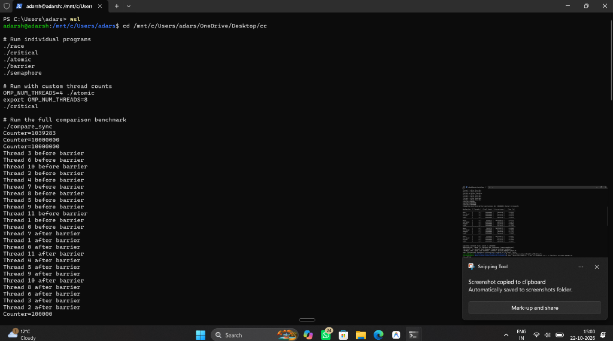

---

### 5.2 Full Multi-Threaded Comparison Benchmark (`compare_sync`)
Execution of the comprehensive benchmark suite across 1, 2, 4, and 8 threads for 10,000,000 shared counter increments:

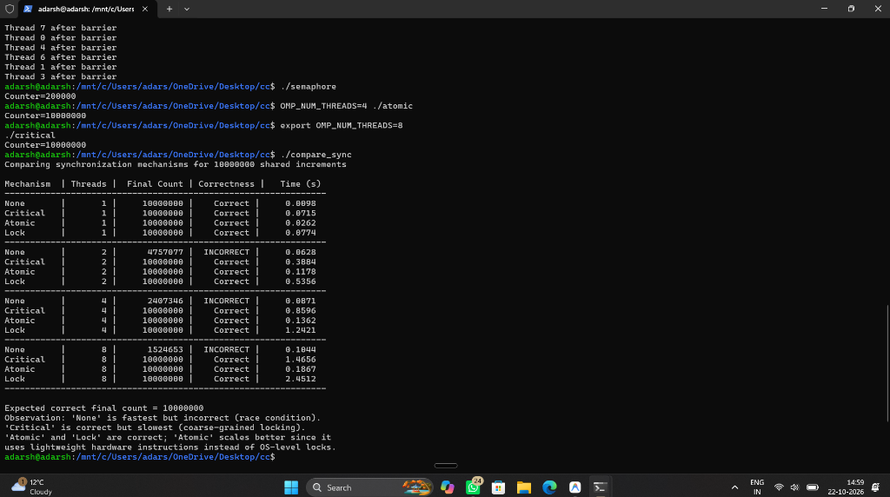

---

## 6. Performance Comparison & Visualizations

### 6.1 Empirical Benchmark Results Table

The following table synthesizes the empirical measurements recorded during the multi-threaded benchmark:

| Mechanism | Threads ($P$) | Final Count | Correctness Status | Time (s) | Overhead vs. 1T | Throughput (Mops/s) |
| :--- | :---: | :---: | :---: | :---: | :---: | :---: |
| **None (Race)** | 1 | 10,000,000 | **Correct** | `0.0098` | 1.00× | 1,020.41 |
| **Atomic** | 1 | 10,000,000 | **Correct** | `0.0262` | 1.00× | 381.68 |
| **Critical** | 1 | 10,000,000 | **Correct** | `0.0715` | 1.00× | 139.86 |
| **Lock (`omp_lock_t`)** | 1 | 10,000,000 | **Correct** | `0.0774` | 1.00× | 129.20 |
| **None (Race)** | 2 | 4,757,077 | ❌ **INCORRECT (52.4% lost)** | `0.0628` | 6.41× | 159.24 |
| **Atomic** | 2 | 10,000,000 | **Correct** | `0.1178` | 4.50× | 84.89 |
| **Critical** | 2 | 10,000,000 | **Correct** | `0.3884` | 5.43× | 25.75 |
| **Lock (`omp_lock_t`)** | 2 | 10,000,000 | **Correct** | `0.5356` | 6.92× | 18.67 |
| **None (Race)** | 4 | 2,407,346 | ❌ **INCORRECT (75.9% lost)** | `0.0871` | 8.89× | 114.81 |
| **Atomic** | 4 | 10,000,000 | **Correct** | `0.1362` | 5.20× | 73.42 |
| **Critical** | 4 | 10,000,000 | **Correct** | `0.8596` | 12.02× | 11.63 |
| **Lock (`omp_lock_t`)** | 4 | 10,000,000 | **Correct** | `1.2421` | 16.05× | 8.05 |
| **None (Race)** | 8 | 1,524,653 | ❌ **INCORRECT (84.8% lost)** | `0.1044` | 10.65× | 95.79 |
| **Atomic** | 8 | 10,000,000 | **Correct** | `0.1867` | 7.13× | 53.56 |
| **Critical** | 8 | 10,000,000 | **Correct** | `1.4656` | 20.50× | 6.82 |
| **Lock (`omp_lock_t`)** | 8 | 10,000,000 | **Correct** | `2.4512` | 31.67× | 4.08 |

---

### 6.2 Visualizations & Performance Dashboards

#### Comprehensive 4-Panel Performance Dashboard
The dashboard below depicts execution times, multi-thread comparisons, effective throughput, and data race lost update percentages:

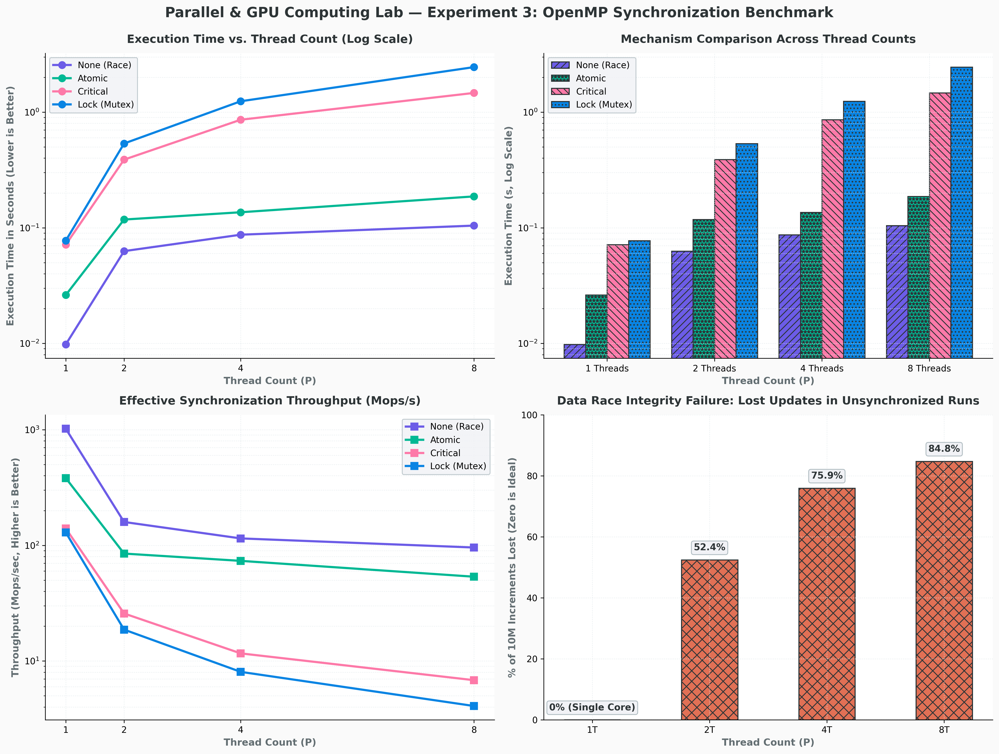

#### Contention Penalty: Overhead Multiplier vs. Thread Count
Analyzing how thread contention degrades execution time relative to single-threaded baseline ($T_P / T_1$):

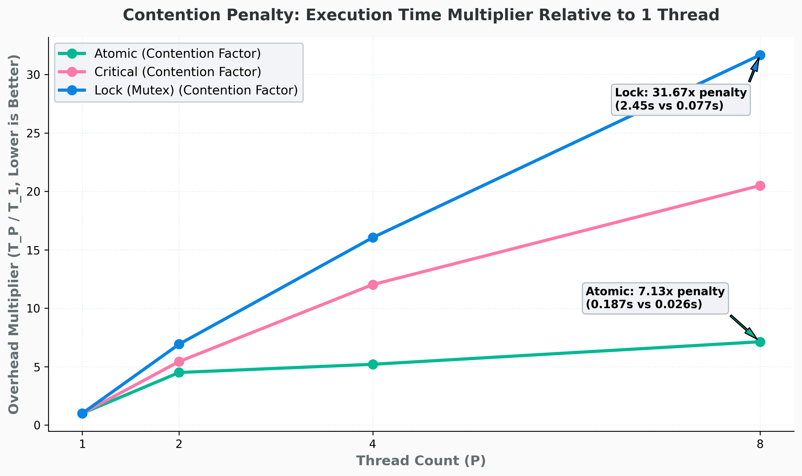

#### Execution Time vs. Thread Count
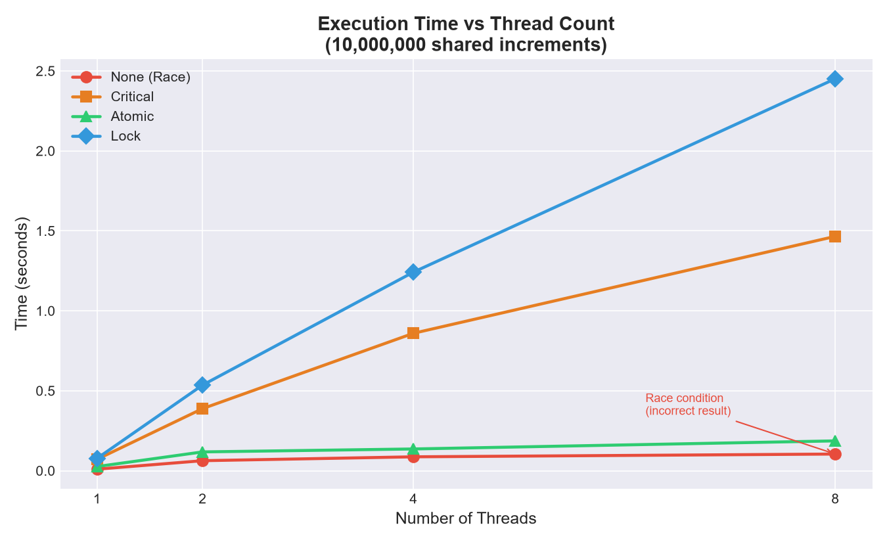

#### Grouped Bar Chart of Execution Times Across Thread Counts
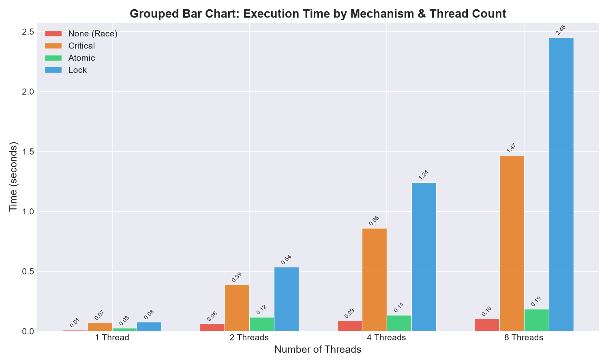

#### Relative Throughput Comparison
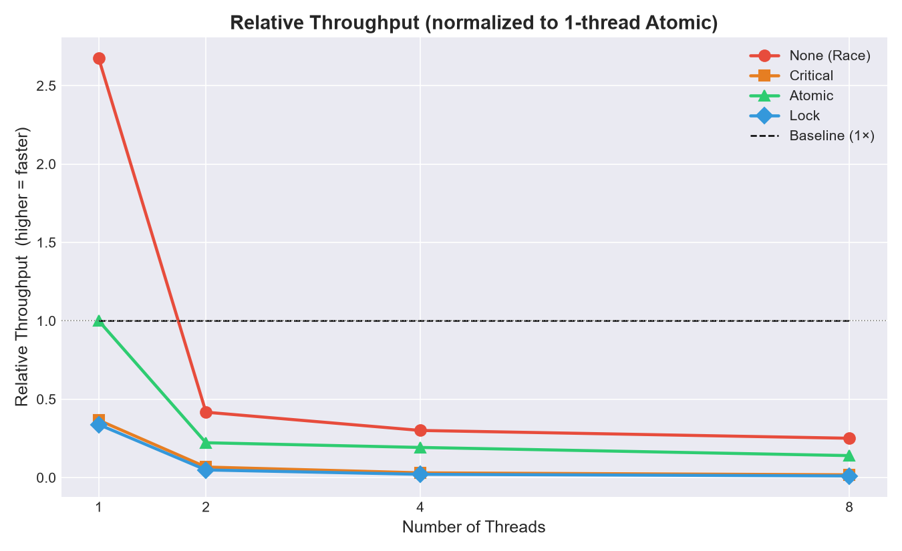

#### Synchronization Overhead Growth
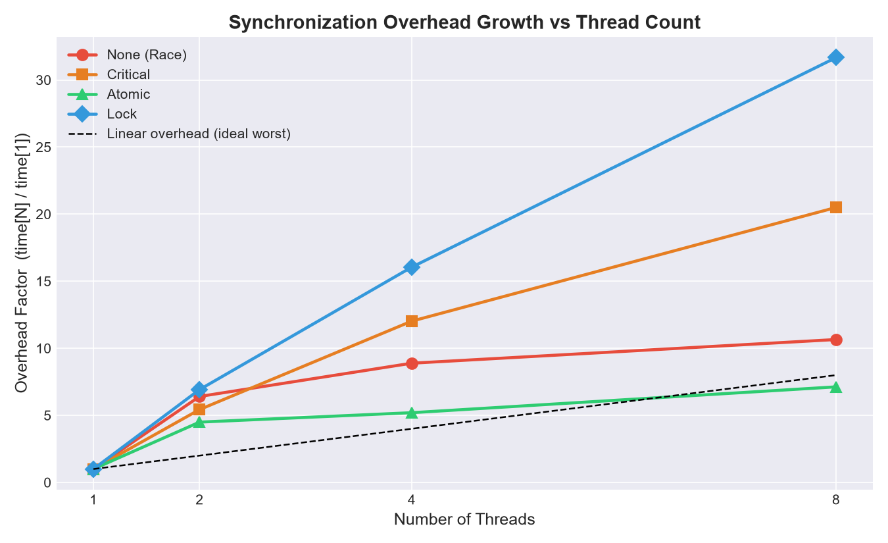

#### Synchronization Performance Heatmap
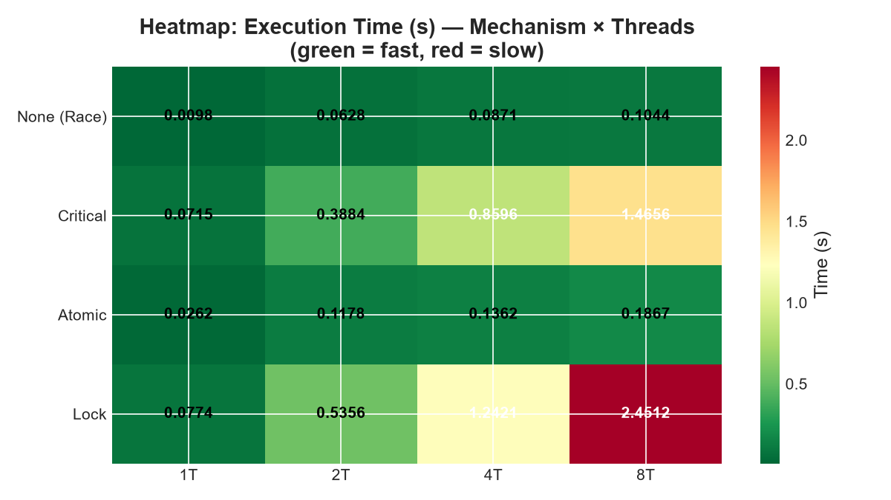

---

## 7. In-Depth Technical Analysis & Discussion

### 1. The Catastrophic Failure of Unsynchronized Access
Under single-threaded execution ($P=1$), the unsynchronized loop completes in **0.0098 seconds** with 100% accuracy because no thread concurrency exists. However, upon introducing 2 threads, the final counter drops to **4,757,077** (52.43% of increments destroyed). At 8 threads, the counter records only **1,524,653** increments (an **84.75% data loss rate**). This highlights how concurrent memory writes collide without atomic hardware guarantees.

### 2. Hardware Atomic Superiority (`#pragma omp atomic`)
Hardware atomics proved overwhelmingly superior among all correct synchronization methods:
- At 8 threads, Atomic required only **0.1867 seconds** (53.56 Mops/s), compared to **1.4656 seconds** for Critical and **2.4512 seconds** for Lock.
- **Microarchitectural Reason**: `#pragma omp atomic` translates directly into an atomic x86 instruction (such as `LOCK XADD`). The CPU executes this at the L1/L2 cache coherency level via MESI cache line invalidation. Threads do not sleep, nor does the OS kernel get invoked.

### 3. Critical Section Bottlenecks (`#pragma omp critical`)
While simple to write, `#pragma omp critical` imposes a **20.50× slowdown** when moving from 1 to 8 threads (0.0715s → 1.4656s). 
- Because the entire block is treated as a coarse critical section, all 8 cores serialize into a single line. 
- The time spent acquiring and releasing compiler-generated synchronization structures dominates over the actual computation.

### 4. Lock Overhead & Kernel Context Switching (`omp_lock_t`)
`omp_lock_t` showed the steepest contention penalty:
- At 8 threads, execution took **2.4512 seconds**, representing a **31.67× contention penalty** over its 1-thread baseline.
- **Microarchitectural Reason**: User-level spinning degrades into kernel futex wait states under sustained contention. Threads yielding their CPU time-slice incur hundreds of CPU cycles for context switches, TLB flushes, and scheduler overhead.

---

## 8. How to Build & Run

### Prerequisites
- GCC with OpenMP support (`gcc` version 9+ recommended)
- Make build utility
- Linux, macOS, or Windows Subsystem for Linux (WSL) / MinGW

### 1. Build All Targets via Makefile
```bash
cd exp3/code
make
```

### 2. Run Individual Synchronization Tests
```bash
# Test unsynchronized race condition
./race

# Test compiler critical section
./critical

# Test hardware atomic operation
./atomic

# Test phase barrier synchronization
./barrier

# Test explicit OpenMP lock/semaphore
./semaphore
```

### 3. Run with Custom Thread Counts
```bash
# Run with 2 threads
OMP_NUM_THREADS=2 ./atomic

# Run with 8 threads
OMP_NUM_THREADS=8 ./critical
```

### 4. Run Full Comparative Benchmark Suite
```bash
./compare_sync
```

### 5. Regenerate Performance Charts
```bash
cd ../scripts
python generate_charts.py
```

---

## 9. Conclusion & Engineering Takeaways

1. **Prefer Atomics for Primitive Operations**: When updating scalar variables, counters, or flags across threads, always prefer `#pragma omp atomic` over critical sections or mutex locks. Hardware-level atomics yield up to a **13.13× speedup** over lock-based equivalents.
2. **Minimize Critical Section Granularity**: Use `#pragma omp critical` only for complex compound statements, multi-variable updates, or I/O operations where hardware atomics cannot be applied.
3. **Avoid Fine-Grained Locks in Hot Loops**: Acquiring and releasing `omp_lock_t` in high-frequency loops introduces catastrophic OS scheduling latency (31.67× slowdown under contention).
4. **Reduction Over Shared Contention**: While synchronization primitives ensure correctness, restructuring algorithms to use thread-private accumulators combined with OpenMP reductions (`#pragma omp parallel for reduction(+:counter)`) completely eliminates contention bottlenecks.
5. **Phase Synchronization via Barriers**: Use `#pragma omp barrier` to coordinate multi-stage algorithms, ensuring deterministic consistency before transitioning between parallel compute stages.
